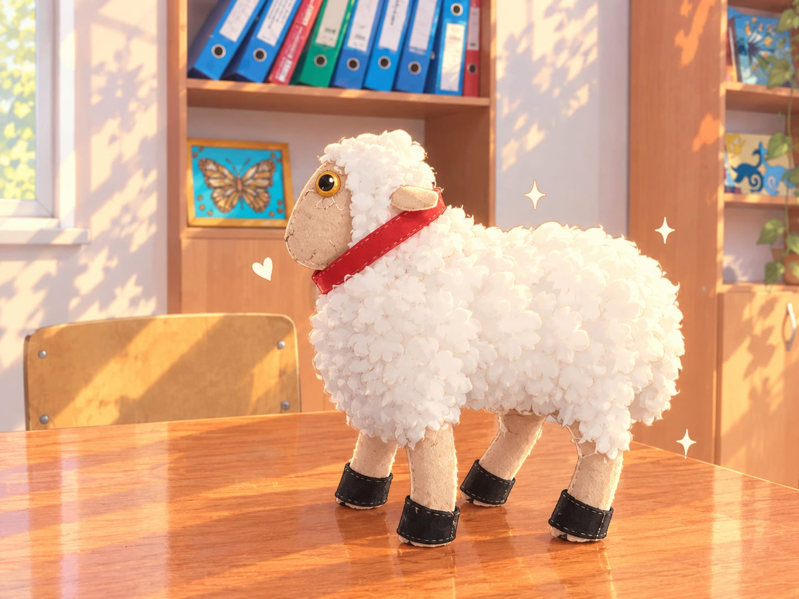
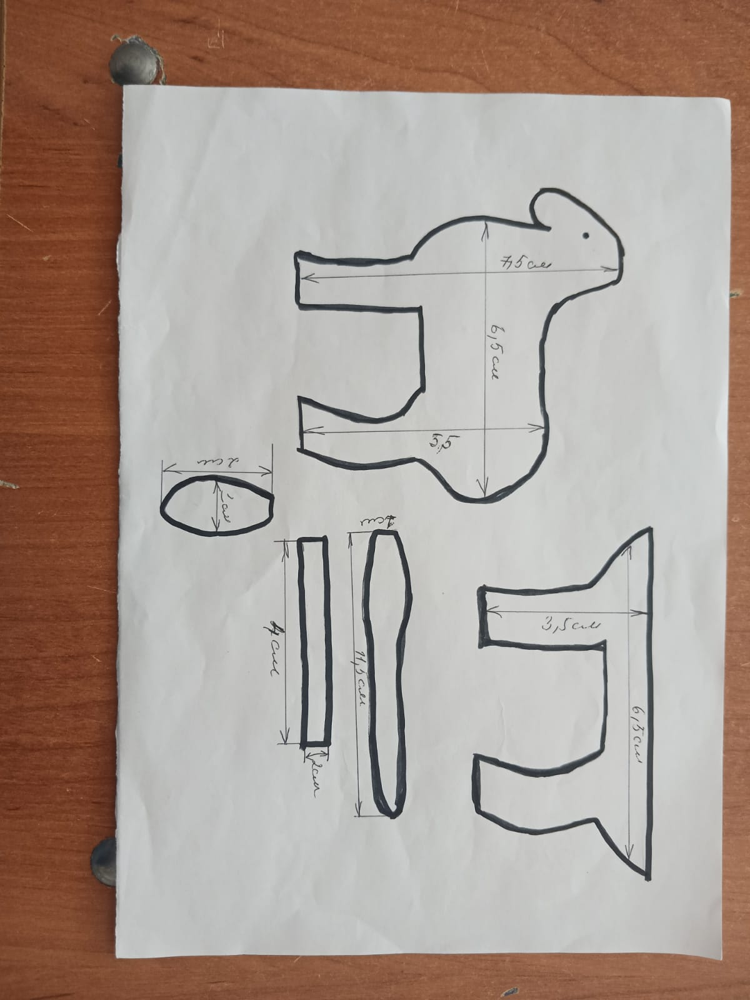

# 🐑 Овечка из фетра

### Пошаговая инструкция по созданию кудрявой мягкой игрушки своими руками

<!-- 📸 ШАБЛОН КАРТИНКИ №1: готовая игрушка -->
<!-- Загрузите фото в папку images/ и замените имя файла ниже -->

*Пушистая белая овечка с бежевой мордочкой, красным ошейником и чёрными копытцами*

---

## 📑 Содержание

1. [Материалы и инструменты](#-материалы-и-инструменты)
2. [Выкройка](#-выкройка)
3. [Вырезание деталей](#️-вырезание-деталей)
4. [Вышивание деталей](#-вышивание-деталей)
5. [Сборка](#-сборка)
6. [Кудрявая шерсть](#-кудрявая-шерсть)
7. [Финальные штрихи](#-финальные-штрихи)

---

## 🧵 Материалы и инструменты

| Материал | Для чего |
|---|---|
| 🟤 Бежевый фетр | Мордочка, ноги, уши |
| ⚪ Белый фетр | Кудрявая «шерсть» на теле |
| ⚫ Чёрный фетр | Копытца |
| 🔴 Красный фетр или лента | Ошейник |
| 🟡 Жёлтые бусины или фетр | Глаза |
| 🪡 Нитки мулине: бежевые, белые, чёрные, красные | Швы и вышивка |
| ☁️ Синтепон или холлофайбер | Наполнитель |

**Инструменты:** бумага, карандаш, линейка, ножницы, иголка, булавки, мел для ткани.

---

## 📐 Выкройка

<!-- 📸 ШАБЛОН КАРТИНКИ №2: выкройка -->
<!-- Загрузите фото выкройки в папку images/ и замените имя файла ниже -->

  

Перенесите выкройки на бумагу **в натуральную величину**, соблюдая указанные размеры, и вырежьте шаблоны.

| № | Деталь | Размер | Кол-во |
|:-:|---|---|:-:|
| 1 | Туловище с двумя ногами (боковая деталь) | 7,5 × 6,5 см, нога 3,5 см | 2 шт ⚠️ |
| 2 | Деталь с двумя ногами (вставка между половинками) | 3,5 × 6,5 см | 1 шт ⚠️ |
| 3 | Длинная вставка (голова и шея) | длина 11,5 см | 1 шт ⚠️ |
| 4 | Прямоугольник для копытец | 4 × 2 см | 4 шт ⚠️ |
| 5 | Уши | овал 2 × 1 см | 2 шт ⚠️ |

> [!NOTE]
> ⚠️ Назначение деталей и количество определены по форме на чертеже и по фото готовой игрушки. Размеры на чертеже написаны от руки: проверьте их и, если нужно, поправьте таблицу.

---

## ✂️ Вырезание деталей

1. **Приколите** бумажные шаблоны булавками к фетру и обведите их мелом или карандашом.
2. **Вырежьте** детали: основу из бежевого фетра, копытца из чёрного.
3. **Сравните** детали: сложите их друг с другом и подровняйте края, чтобы они совпадали по размеру и форме.
4. Из **белого фетра** нарежьте много маленьких «облачков» или «цветочков» диаметром 1,5–2,5 см. Это будущие кудряшки.
5. Из **красного фетра** вырежьте полоску для ошейника.

> [!TIP]
> Чем больше кудряшек разного размера, тем пушистее получится овечка. Заготовьте их с запасом.

---

## 🪡 Вышивание деталей

Все детали вышиваются **обмёточным швом** (петельным швом).

**Как делать обмёточный шов:**

1. Выведите иглу на лицевую сторону у самого края детали.
2. Сделайте новый вкол на 3–4 мм дальше и проведите иглу под нитку, так чтобы она легла петлёй по краю.
3. Затяните нитку не слишком туго и повторяйте шаги по всей длине края.

**Порядок работы:**

1. Обшейте края ушей и копытец.
2. Соедините детали туловища, головы и ног, оставив небольшое отверстие для набивки.

---

## 🧸 Сборка

1. Сложите две половины туловища лицевой стороной наружу и соедините их вставками.
2. Набейте игрушку наполнителем. Ноги и шею набивайте **плотнее**, чтобы овечка устойчиво стояла.
3. Зашейте отверстие потайным швом.
4. Оберните копытца вокруг нижней части ног и сшейте края.
5. Пришейте уши по бокам головы.

---

## ☁️ Кудрявая шерсть

1. Начните пришивать белые кудряшки с нижней части туловища и двигайтесь вверх.
2. Каждую кудряшку закрепляйте несколькими стежками по центру, а края оставляйте свободными, чтобы они топорщились.
3. Укладывайте кудряшки внахлёст, чтобы не осталось просветов.
4. На голове оставьте открытой мордочку, а на лбу сделайте небольшую «чёлку» из кудряшек.

---

## ✨ Финальные штрихи

- Пришейте жёлтые бусины-глаза или вышейте их.
- Вышейте носик и ротик тёмной ниткой.
- Завяжите или пришейте красный ошейник на шее.

**Готово! 🎉 Ваша овечка может отправляться на пастбище.**

---

Сделано с ❤️ своими руками

